# Alto

## **Alto is a vibecoded modification of Baritone. It is not made by the Baritone team, and the Baritone team does not support it.**

Alto is a fork of [Baritone](https://github.com/cabaletta/baritone) for Minecraft 1.21.1 (NeoForge). Baritone walks,
mines, builds and farms for you. Alto adds what Baritone cannot do: use chests, crafting tables, furnaces and modded
machines the way a player does.

Report problems with Alto in this repository, not to the Baritone team.

## Requirements

- Minecraft 1.21.1 with NeoForge 21.1 (tested with 21.1.249).
- Nothing else. Create, EMI, Sophisticated Storage, Open Parties and Claims, Corpse, Farmer's Delight and Lootr are
  optional: Alto works with them when they are installed and without them when they are not.

## Install

1. Back up your game or modpack instance.
2. Put the Alto jar in your `mods` folder.
3. Remove any other Baritone jar. Alto replaces Baritone; the two cannot be installed together.

Alto runs on your client only. Servers do not need it. Check a server's rules before using automation on it.

Commands start with `#`, like in Baritone. `#help` lists them.

## Features

### Crafting

Alto crafts what a job needs. It uses the 2x2 grid in your inventory, or a crafting table it finds, or one it places
and picks up again.

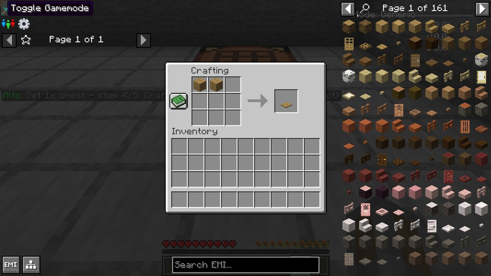
*`#craft chest 1` with only logs: Alto crafted planks, placed a crafting table and is filling its grid. It picks the table up again afterwards.*

- `#craft chest 1` gets one chest: from your inventory, your storage, or by crafting, smelting or mining.
- `#plan chest 1` shows the steps without doing them.
- When the builder runs out of a block, Alto makes more. Hold oak logs, select an area, and `#sel fill oak_planks`
  fills it with planks.

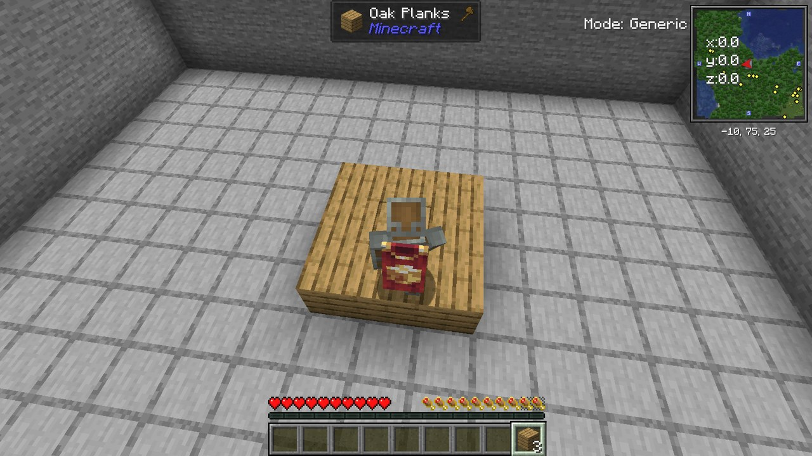
*`#sel fill oak_planks` while holding only oak logs. The builder ran out of planks, so Alto crafted more and the build continued.*

### Smelting

Alto smelts in a furnace it finds or places. It never burns valuable fuel.

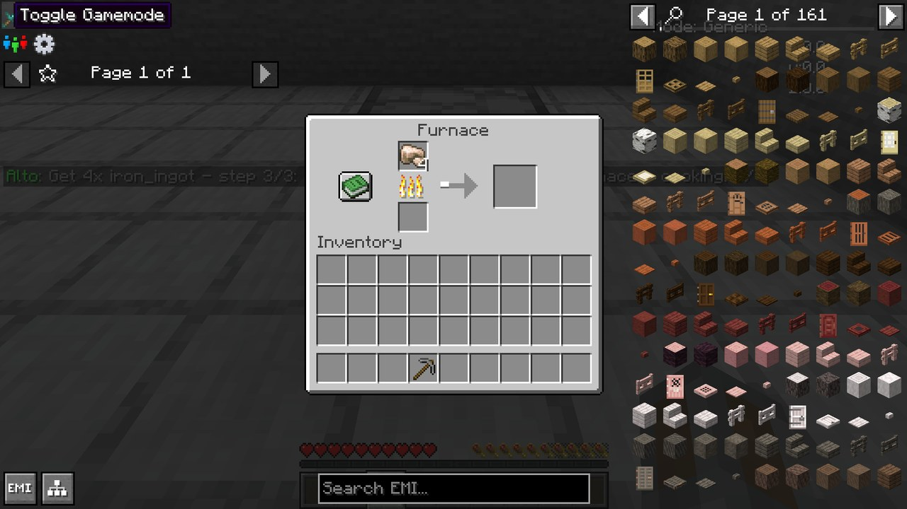
*Alto placed a furnace, smelts raw iron with coal from your inventory, and picks the furnace up when it is done.*

### Storage

Mark a storage room and Alto remembers what is in every container there.

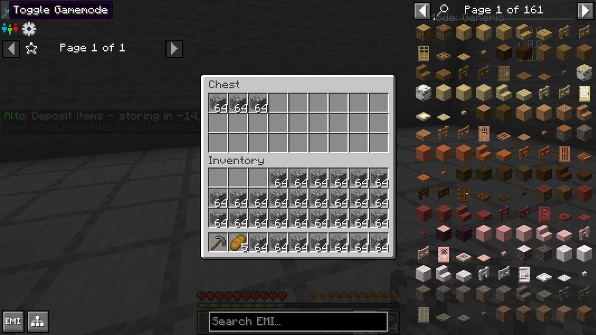
*`#deposit` puts your items into the chests of your storage zone. Tools, food and armor stay in your inventory.*

- `#home zone add storage` turns your selection (`#sel 1`, `#sel 2`) into a storage zone.
- `#fetch cobblestone 64` takes exactly 64 from your storage.
- `#deposit` puts away everything except tools, food and armor.
- Shulker boxes you carry work like storage too.

While Baritone works, Alto can deposit when your inventory is full, restock torches and food, replace a pickaxe that
is about to break, and eat when you are hungry. Each helper has an on/off setting.

### Building

`#build` and `#sel fill` get their materials from your storage first, then craft or mine what is missing.
`#materials` prints the shopping list of a build.

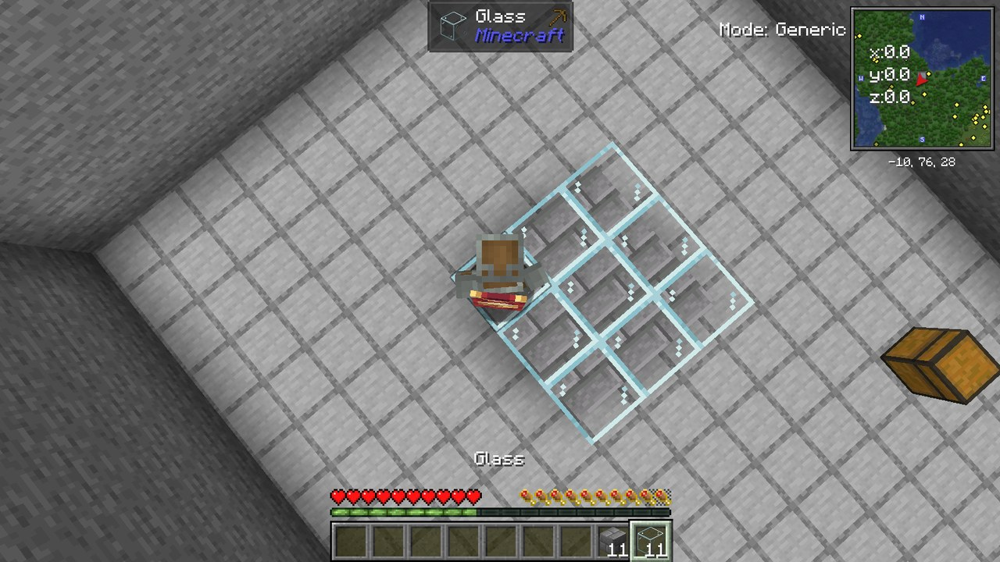
*Before this build started, Alto listed the materials and fetched the stone bricks and glass from storage in one trip.*

### Farming

`#farm` also handles modded crops and fetches seeds from your storage when you run out.

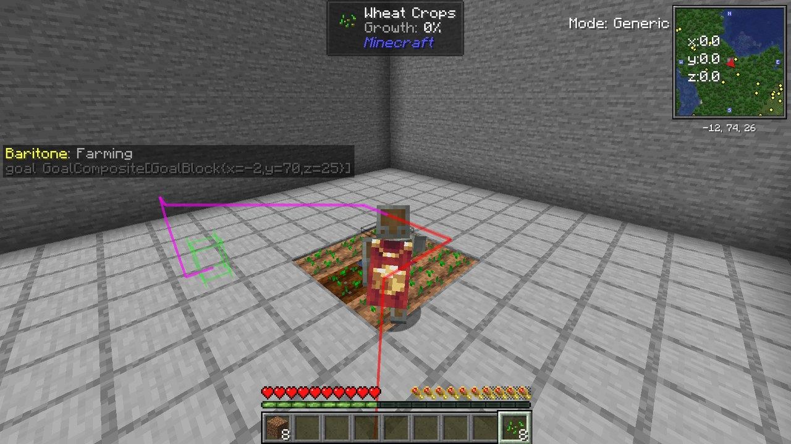
*`#farm` with no seeds in the inventory: Alto fetched seeds from a chest and planted the field.*

### Travel

- `#goto x y z nether` (or `overworld`) travels through the nether portal that means the least walking.
  Alto remembers the portals it sees. It can build a portal if you allow it (off by default).
- `#minecart` rides a minecart. `#boat x z` crosses water by boat and picks the boat up again.

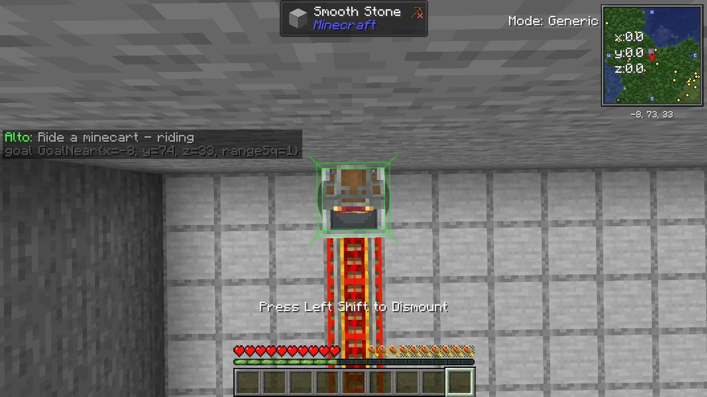
*`#minecart` boards the nearest free minecart and gets off at the end of the line.*

### Safety

- The **End** key stops everything at once (`#stop` does the same).
- Low health or a hostile mob nearby pauses everything. `#resume` continues. Alto never fights.
- Paths never break machines, chests, signs or train tracks (setting `altoProtectMachines`).

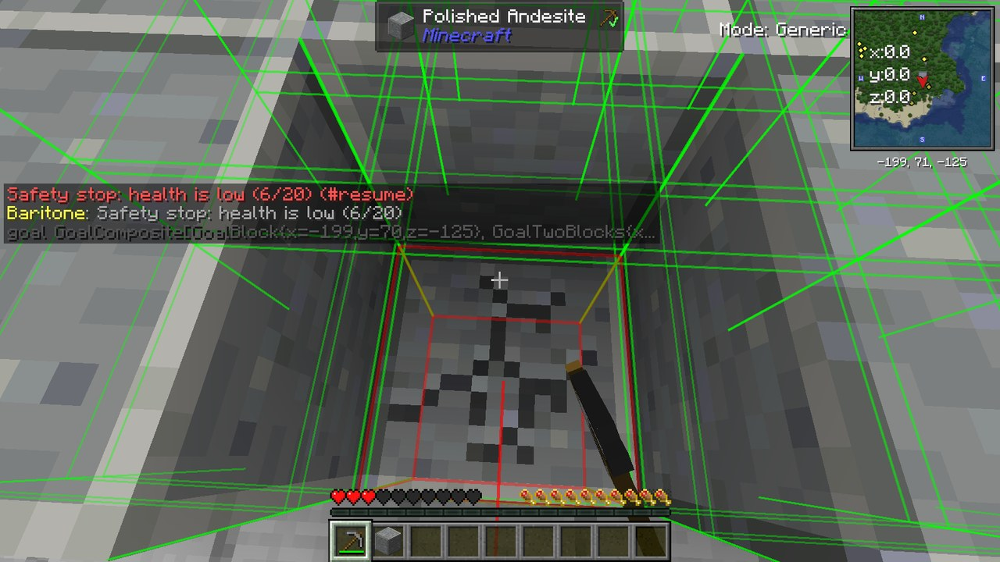
*Health dropped while mining: everything paused, and the HUD (top left) shows why. `#resume` continues, `#stop` ends the job.*

### Progress and settings

Press **H** for a small progress display. `#alto settings` (or Mods > Alto > Config) opens the settings screen.

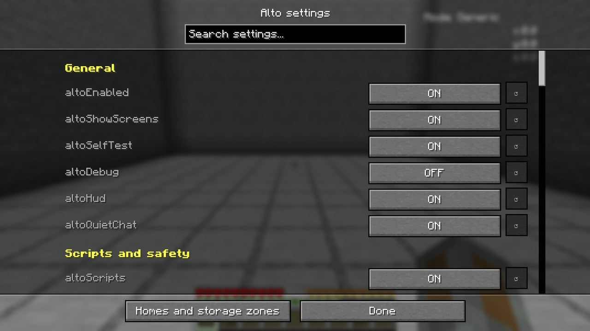
*The settings screen: every Alto setting in groups, with search and a reset button for each.*

### Scripts

Make scripts with blocks in the script editor (`alto-editor/dist/alto-script-editor.html`, works offline in any
browser), save them to `.minecraft/baritone/alto/scripts/`, and run them with `#script run <name>`. Alto asks before
a new script runs for the first time.

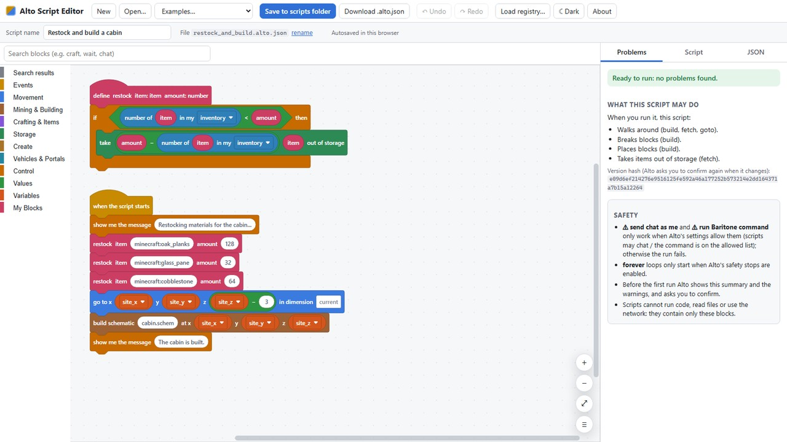
*The script editor with an example script. The right side lists problems and what the script is allowed to do.*

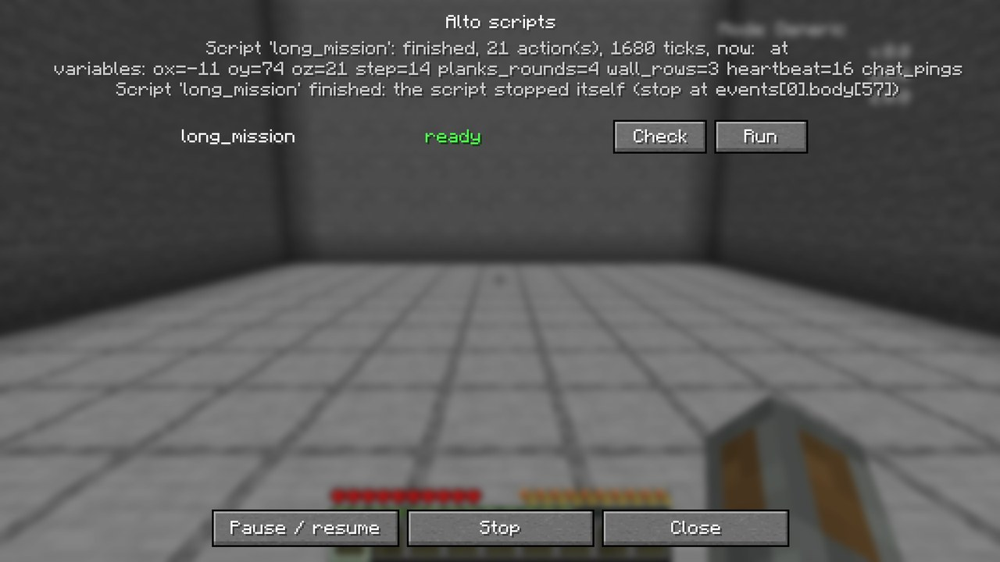
*The script runner screen (`#script gui`): check, run, pause and stop your scripts.*

## Mods

### Create

- `#train <from> -> <to>` walks to a station, boards a train, rides it and gets off at the destination.
- `#elevator <floor>` picks the floor on an elevator's controls and rides.
- `#order <item> <count>` orders from a stock keeper.
- `#filter <item>` sets the filter of the deployer, funnel or chute you look at.
- Baritone waits while you stand on a moving contraption, walks around running saws, drills and fans, and never
  breaks shafts, belts or tracks to make a path.

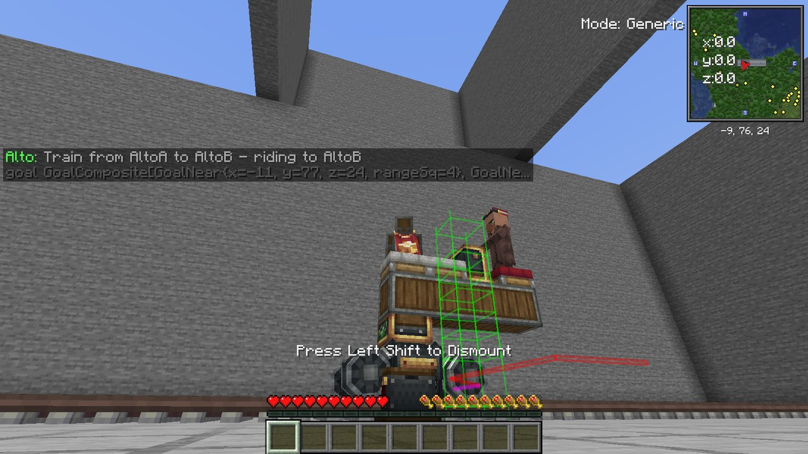
*`#train`: riding a Create train between two named stations.*

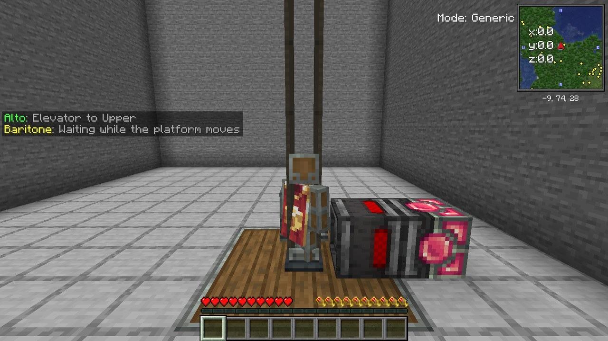
*`#elevator Upper`: Alto picked the floor on the cab's controls with the scroll wheel, right-clicked, and rides up.*

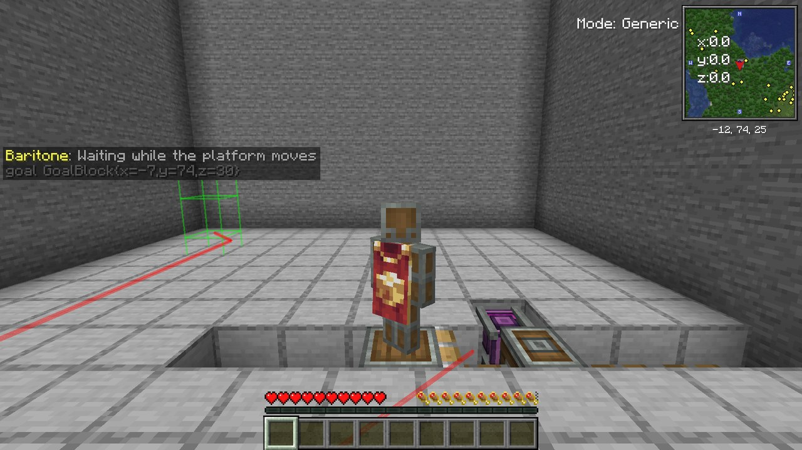
*Standing on a piston platform while it moves: Baritone waits, then walks on from where the platform stopped.*

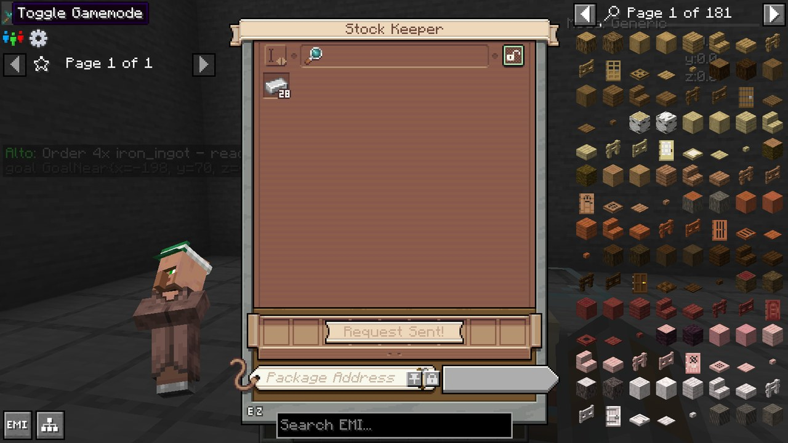
*`#order iron_ingot 4`: Alto opened the stock keeper and sent the order through its normal screen.*

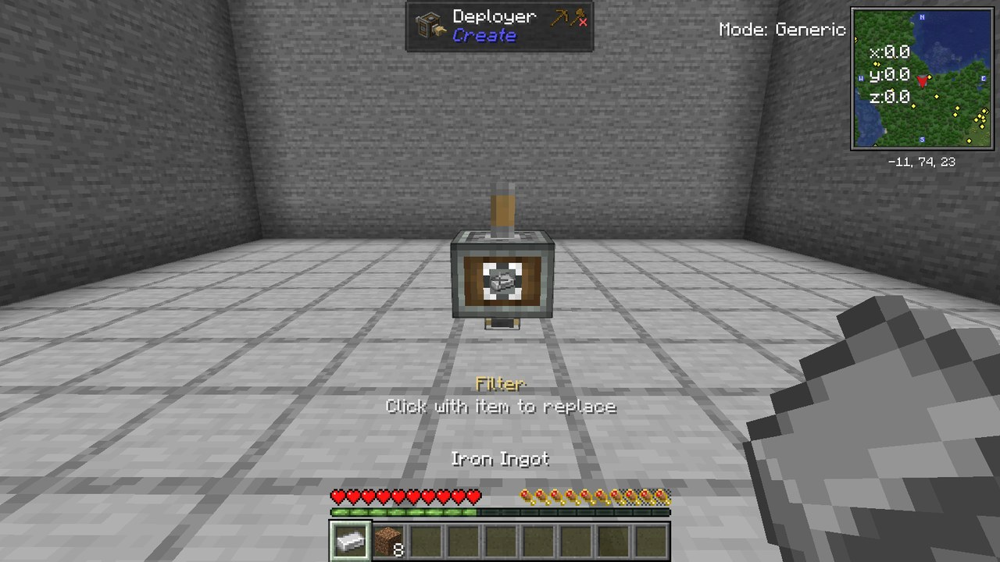
*`#filter iron_ingot` while looking at a deployer: the filter is set and the ingot stays in your inventory.*

### EMI

Look at a block and press **Y** to mark it, then hover an item in EMI and press **Y** again: the item becomes the
block's filter. Without marked blocks, Alto offers to fetch, craft or mine the item.

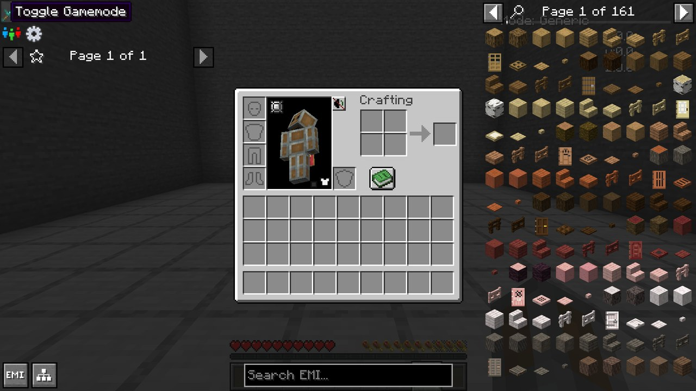
*With a block marked (Y), hover an item in EMI's list and press Y: that item becomes the block's filter.*

### Sophisticated Storage and Backpacks

Their chests, barrels and placed backpacks work as storage. Upgrades you hold are never applied by accident.

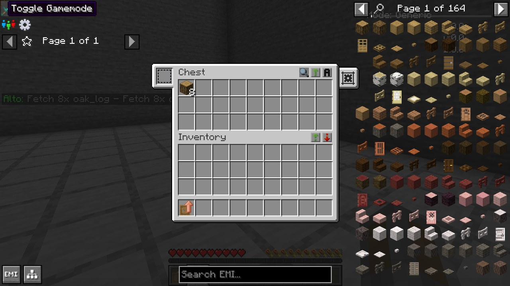
*`#fetch` taking logs from a Sophisticated Storage chest. The upgrade in your hand is not applied to it.*

### Open Parties and Claims

Baritone never breaks or places blocks in someone else's claim. Alto can only see the claims your server shares
with clients.

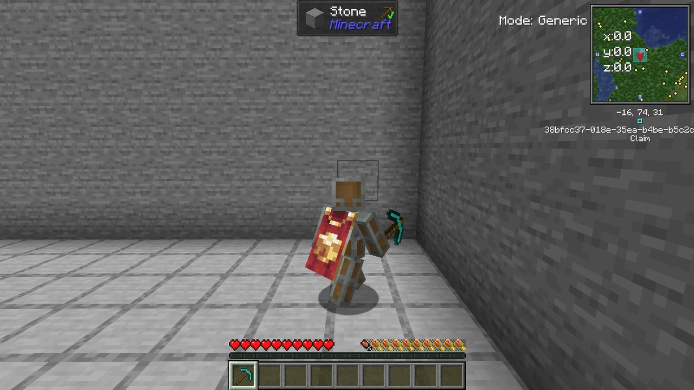
*This wall is inside another player's claim. Baritone walks around it instead of breaking through.*

### Corpse

`#corpse` walks back to your corpse and takes your items.

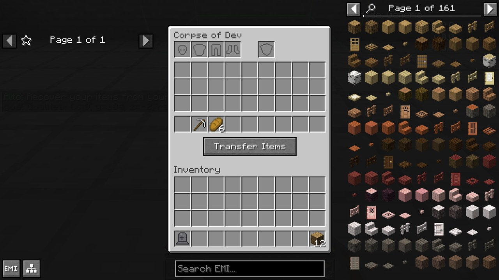
*`#corpse` after dying: Alto walked back, opened the corpse and takes everything back.*

### Farmer's Delight

`#farm` harvests and replants cabbages, onions and the other crops. Tomatoes are left alone.

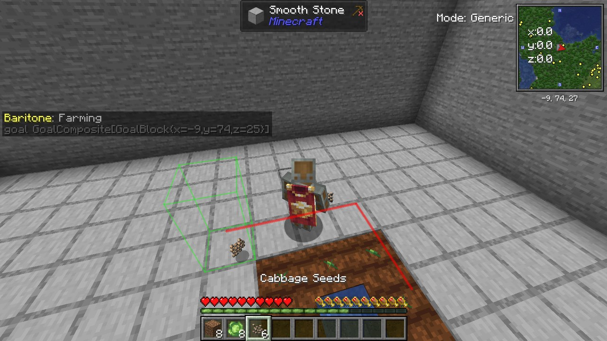
*`#farm` harvested these Farmer's Delight cabbages and replanted them from the seeds they dropped.*

### Lootr

Lootr chests are never used to store your items.

## Chat

By default Alto only tells you results, problems and answers to your commands. The steps of a job are shown in the
progress display (H). `#set altoQuietChat false` shows every step in chat, which helps when something goes wrong.

## Building from source

Requires JDK 21.

```
./gradlew build
```

The jar is in `build/libs`. The build downloads the mods Alto works with only to compile against them; none of their
code is included in the Alto jar.

## License

Alto is licensed under the GNU Lesser General Public License v3.0, like Baritone. See [LICENSE](LICENSE) and
[docs/alto/LICENSE-NOTE.md](docs/alto/LICENSE-NOTE.md). If you share the jar, you must also share its source code.

Baritone is made by leijurv, Brady and the [Baritone contributors](https://github.com/cabaletta/baritone/graphs/contributors).
The original Baritone README is in [README-baritone.md](README-baritone.md).

More documentation: [user guide](docs/alto/USER_GUIDE.md), [install](docs/alto/INSTALL.md),
[script language](docs/alto/SCRIPT_LANGUAGE.md), [developer notes](docs/alto/DEVELOPER.md),
[changelog](docs/alto/CHANGELOG.md).
