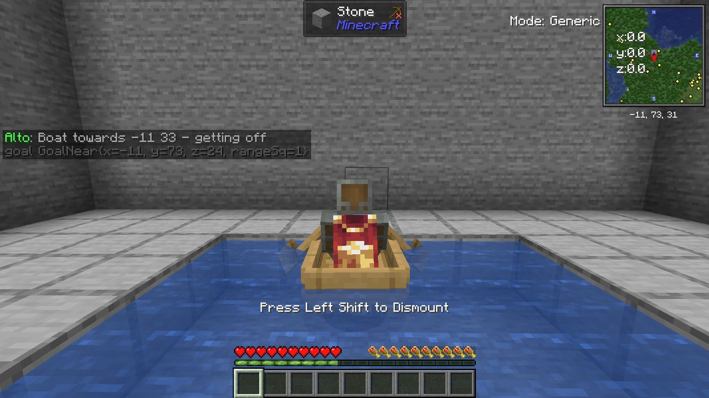

# Alto user guide

**Alto is a vibecoded modification of Baritone. It is not made by the Baritone team, and the Baritone team does not
support it.**

Alto adds container use (chests, crafting tables, furnaces, modded machines) to Baritone. Everything Baritone does
still works the same way. Commands start with `#`. `#help <command>` explains any command.

Alto runs on your client only. It sends the same packets a normal player sends, at a calm pace (4 clicks per second
by default). Check a server's rules before using it there; Alto reminds you once per server.

Contents: [Crafting](#crafting) · [Storage](#storage) · [Helpers](#helpers) · [Building](#building) ·
[Farming](#farming) · [Travel](#travel) · [Safety](#safety-stopping-and-the-hud) · [Settings](#settings) ·
[Chat](#chat) · [Scripts](#scripts) · [Create](#create) · [EMI](#emi) · [Other mods](#other-mods) ·
[Files](#where-alto-keeps-its-files)

## Crafting


*`#craft chest 1` with only logs: Alto crafted planks, placed a crafting table and is filling its grid. It picks the table up again afterwards.*

| Command | What it does |
|---|---|
| `#craft <item> [count]` | Gets that many more of the item: from your inventory, carried shulker boxes, your storage, or by crafting, smelting or mining. |
| `#plan <item> [count]` | Shows the steps and how long they take, without doing them. |

Alto uses the 2x2 grid when it can, otherwise a crafting table: one nearby, or one it places and picks up again.
`#set alwaysUseCraftingStation true` makes it always use a table.

Alto never uses items on the "never consume" list (diamonds, netherite and similar by default) and never burns
valuable fuel. With EMI installed, the recipes you picked in EMI's recipe tree are preferred.


*Alto placed a furnace, smelts raw iron with coal from your inventory, and picks the furnace up when it is done.*

## Storage

Alto only uses containers inside your storage zones.

```
#home set                      set your home where you stand
#sel 1, #sel 2                 select your storage room
#home zone add storage         make the selection a storage zone called "storage"
#home zone scan storage        open every container once so Alto knows what is inside
```


*`#fetch` opens a chest in your storage zone and takes exactly the number of items you asked for.*

| Command | What it does |
|---|---|
| `#fetch <item> [count]` | Takes exactly that many from your storage. |
| `#deposit` | Puts away everything except tools, food, armor and your keep list. |
| `#home storage [item]` | Shows what is stored where. |
| `#shulker ...` | Uses the shulker boxes you carry: list, take from, put into. |
| `#home zone rules <zone> <items...>` | Only these items are deposited in that zone. |

Chests, barrels, shulker boxes, hoppers, droppers, and Sophisticated Storage chests, barrels and placed backpacks all
work. Lootr chests and corpses are never used to store your items.

## Helpers

These run while Baritone mines, builds, farms or explores. They pause the job and let it continue afterwards.

| Helper | Default | Setting |
|---|---|---|
| Deposit when the inventory is nearly full | on (needs a storage zone) | `altoAutoDeposit` |
| Restock torches, food and other items from storage | on (needs a storage zone) | `altoRestock`, `altoRestockItems` |
| Replace a tool that is about to break | on | `altoToolUpkeep` |
| Eat when hungry | off | `altoAutoEat` |
| Compress items into blocks when the inventory is full | off | `altoCompress` |

## Building

With only oak logs in your inventory:

```
#sel 1                (look at one corner)
#sel 2                (look at the other corner)
#sel fill oak_planks
```

When the builder runs out of planks, Alto crafts more from your logs, puts them on your hotbar, and the build goes on.
The same works for `#build <schematic>` and any block Alto knows how to get. At the start of a build, Alto fetches what
your storage has in one trip.


*`#sel fill oak_planks` while holding only oak logs. The builder ran out of planks, so Alto crafted more and the build continued.*

| Command | What it does |
|---|---|
| `#materials [file] [fetch]` | Shopping list for the current build or a schematic file; `fetch` gets what fits from storage. |

## Farming

`#farm [range]` also harvests and replants modded crops (for example Farmer's Delight cabbages and onions). Crops you
harvest by right-clicking, like tomatoes, are left alone. When you run out of seeds, Alto fetches some from storage.


*`#farm` with no seeds in the inventory: Alto fetched seeds from a chest and planted the field.*

## Travel

| Command | What it does |
|---|---|
| `#goto <x> [y] <z> <overworld\|nether>` | Goes through the nether portal that means the least walking, then on to the exact coordinates. |
| `#portals [forget]` | The portals Alto remembers in this world. |
| `#minecart [x z]` | Rides the nearest free minecart. |
| `#boat <x> <z>` | Crosses water in a straight line by boat and picks the boat up again. |

With `altoBuildPortals` on (off by default), Alto builds and lights a portal when it knows none. It needs 10
obsidian, a flint and steel, and some cobblestone.


*`#boat <x> <z>`: Alto placed its boat, crosses the water, and picks the boat up on the other side.*

## Safety, stopping and the HUD

- **End key**: stops the script, Alto's job and Baritone. `#stop` does the same.
- **Safety stops** (on): when your health drops to 4 hearts or a hostile mob comes within 6 blocks, everything pauses.
  Alto never fights. `#resume` continues.
- **Machines are safe** (`altoProtectMachines`, on): paths never break blocks that hold something (machines, chests,
  barrels, signs, Create shafts and belts) or train tracks. To `#mine` such a block, turn the setting off.
- **Progress HUD** (H key, or `#alto hud`): what the script, Alto and Baritone are doing right now.


*Health dropped while mining: everything paused, and the HUD (top left) shows why. `#resume` continues, `#stop` ends the job.*

## Settings

`#alto settings`, or Mods > Alto (unofficial Baritone fork) > Config. Settings are in groups, with a search box and a reset button
for each one. The second page lists your homes and storage zones. `#set <setting> <value>` works too.


*The settings screen: every Alto setting in groups, with search and a reset button for each.*

## Chat

Quiet chat is on by default: Alto only tells you results, problems and answers to your commands. The steps of a job
are in the HUD (H) and in the game log. `#set altoQuietChat false` shows every step in chat, which helps when you want
to see what went wrong.

## Scripts

Make scripts with blocks in the script editor, `alto-script-editor.html`. Open it in any browser; it works offline.
Save scripts as `<name>.alto.json` in `.minecraft/baritone/alto/scripts/` (the editor's Save button can do that).


*The script editor with an example script. The right side lists problems and what the script is allowed to do.*

```
#script list
#script check <name>          what the script may do, and any problems
#script run <name>            the first time, Alto asks you to confirm: #script run <name> confirm
#script pause / resume / stop / status
#script gui                   the script runner screen (key under Controls > Alto)
```


*The script runner screen (`#script gui`): check, run, pause and stop your scripts.*

Scripts never start by themselves. A running script is saved every few seconds; after a restart, Alto asks before it
continues (`#script resume`). Chat triggers only react to text you type. Scripts cannot send chat or run Baritone
commands unless you allow it (`altoScriptChat`, `altoScriptCommands`). The block language is described in
[SCRIPT_LANGUAGE.md](SCRIPT_LANGUAGE.md).

## Create

| Command | What it does |
|---|---|
| `#train <from> -> <to>` | Walks to the first station, waits for a train, sits on a free seat, rides, gets off at the second station. Never touches controls, conductors or schedules. |
| `#stations` | Lists the train stations. |
| `#elevator <floor>` | Picks the floor on the elevator's controls and rides. |
| `#order <item> <count> [address]` | Orders from the nearest stock keeper (only if the server lets you open it). |
| `#filter <item\|hand\|clear>` | Sets the filter of the deployer, funnel, tunnel or chute you look at. The item is not used up. |
| `#useon <item> <x y z> [face]` | Uses an item on a block, for example to put it on a depot. |


*`#train AltoA -> AltoB`: Alto walked to the station, sat on a free seat, and gets off at the next station.*


*`#elevator Upper`: Alto picked the floor on the cab's controls with the scroll wheel, right-clicked, and rides up.*

Also:

- While you stand on a moving contraption (piston, elevator, gantry, bearing), Baritone waits until it stops.
- Running saws, drills, crushing wheels and fans are walked around. The rules are in `baritone/alto/hazards.json`
  (`#alto hazards` reloads them).
- Material lists use Create's own costs (an encased shaft needs a shaft).


*Standing on a piston platform while it moves: Baritone waits, then walks on from where the platform stopped.*


*`#order iron_ingot 4`: Alto opened the stock keeper and sent the order through its normal screen.*


*`#filter iron_ingot` while looking at a deployer: the filter is set and the ingot stays in your inventory.*

## EMI

The pick key (**Y**):

1. Look at a Create deployer, funnel or chute and press Y to mark it.
2. Open your inventory, hover an item in EMI's list and press Y.
3. The item becomes the filter of every marked block.

Without marked blocks, Alto offers to filter, fetch, craft, plan or mine the item you picked. `#pick favorites` lists
your EMI favorites. When Alto cannot make an item, `#plan` names the EMI recipe types that can (for example
"Pressing").


*With a block marked (Y), hover an item in EMI's list and press Y: that item becomes the block's filter.*

## Other mods

- **Sophisticated Storage and Backpacks**: their chests, barrels and placed backpacks are storage. Upgrades you hold
  are never applied by accident.
- **Open Parties and Claims**: Baritone never breaks or places blocks in someone else's claim. Alto sees the claims
  your server shares with clients (server setting `claimsSynchronization`).
- **Corpse**: `#corpse` walks back to your corpse and takes your items. Old, already emptied corpses are skipped.
- **Farmer's Delight**: its crops and rich soil farmland work with `#farm`.
- **Lootr**: Lootr chests are never used to store your items.

`#alto integrations` shows which of these are active. Alto works without any of them, and with other versions of
them: if a mod's version does not fit, only that part of Alto switches itself off.


*`#fetch` taking logs from a Sophisticated Storage chest. The upgrade in your hand is not applied to it.*


*This wall is inside another player's claim. Baritone walks around it instead of breaking through.*


*`#corpse` after dying: Alto walked back, opened the corpse and takes everything back.*


*`#farm` harvested these Farmer's Delight cabbages and replanted them from the seeds they dropped.*

## Self-tests

`#selftest list`, `#selftest <name>` and `#selftest all` run Alto's own test scenarios. They build test setups and
replace your inventory, so they only run in singleplayer worlds whose name starts with `alto_test` (or with `confirm`).

## Where Alto keeps its files

`.minecraft/baritone/alto/`: `worlds/<world>/` (storage index, zones, portals), `scripts/`, `hazards.json`,
`shopping-list.txt`, `selftest/`. Deleting the folder resets what Alto remembers. Your worlds are not touched.
